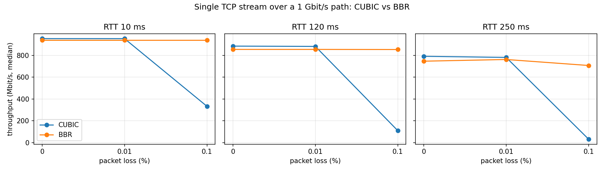
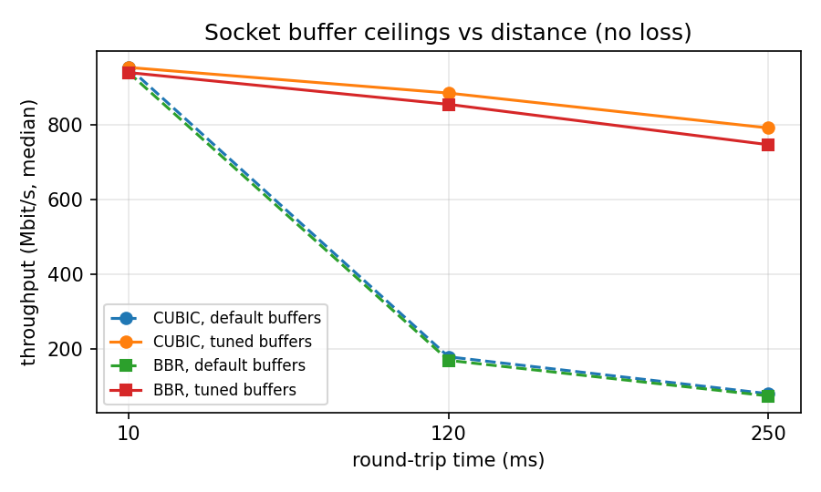
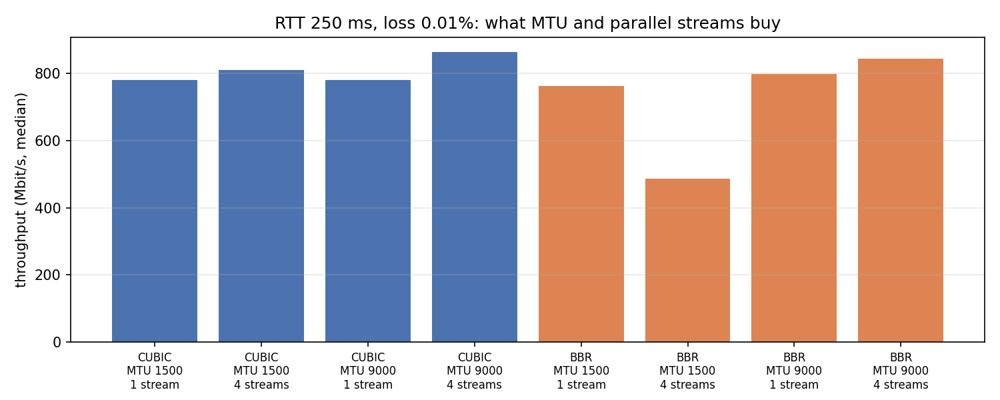

# Part B: TCP over an emulated long fat network

**Question:** a research institute moves large datasets between campuses and across oceans. How much of a 1 Gbit/s path does one TCP transfer actually get as distance and packet loss grow, and what helps?

**Setup** (`partb/lfn.py`, run in GitHub Actions):

- Two Linux network namespaces stand in for two data-transfer nodes, joined by a veth pair.
- `tc netem` adds half the round-trip delay on each side. The sending side also gets a 1 Gbit/s rate limit and random packet loss.
- The emulator's queue holds twice the bandwidth-delay product, so netem itself isn't what drops packets.
- Segmentation offloads are off, so loss and the rate limit apply to real-size packets.
- Each test is a 15-second `iperf3` run. Every configuration was run 3 times in each of two separate CI runs, 6 repetitions in total:
  - [run 41176590070](https://github.com/zbs-ops/research-network-lab/actions/runs/41176590070) (raw data: `results/partb/run-41176590070/`)
  - [run 41178340217](https://github.com/zbs-ops/research-network-lab/actions/runs/41178340217) (raw data: `results/partb/run-41178340217/`)
- Every raw iperf3 JSON is in the repo, with the exact qdisc applied and the measured ping RTT.
- The medians below are in `results/partb/summary.csv`, which `partb/plot.py` builds from both runs' CSVs (the `partb-plots` workflow rebuilds it in CI). Its `measured_rtt_ms` column is the first repetition's.

Round-trip times: **10 ms** (a domestic link, like Tokyo to Kobe), **120 ms** (Japan to the US west coast), **250 ms** (Japan to Europe). In run 41178340217, every measured RTT was within 0.13 ms of its target. In run 41176590070, the first configuration at each RTT measured 20–24% high (for example 144 ms at 120 ms), because the first ping waited for ARP across the delayed path. Only the RTT check was affected, not the delay netem applied; the later run adds an uncounted warm-up ping.

All numbers below are throughput the receiver got, in Mbit/s: median [min to max] of the 6 repetitions.

## 1. Loss is what separates CUBIC from BBR

Single stream, MTU 1500, 0.1% random loss:

| RTT | CUBIC | BBR |
|---|---|---|
| 10 ms | 333 [183–419] | 939 [938–939] |
| 120 ms | 111 [22–253] | 853 [846–853] |
| 250 ms | **33 [8–254]** | **707 [679–717]** |

With no loss, the two are within 6% of each other at every distance (CUBIC slightly ahead: 952 vs 939, 884 vs 854, 791 vs 746). Add 0.1% loss and CUBIC falls apart as the RTT grows, while BBR barely moves. CUBIC treats each loss as congestion and cuts its sending window, and at 250 ms it takes many seconds to grow back. BBR estimates the bottleneck's bandwidth and the path's RTT directly, so random loss that isn't caused by congestion doesn't throttle it.

CUBIC's spread is wide (8 to 254 at 250 ms): in a 15-second test, a single early loss decides most of the result. BBR's spread is narrow.

## 2. Default buffers cap a long transfer at a fraction of the link

No loss, single CUBIC stream, MTU 1500:

| RTT | Ubuntu default buffers | Tuned (256 MB ceiling) |
|---|---|---|
| 10 ms | 952 | 952 |
| 120 ms | 179 [179–180] | 884 [884–884] |
| 250 ms | 81 [80–81] | 791 [788–791] |

To fill a 1 Gbit/s path, a sender must keep a full bandwidth-delay product in flight: 15 MB at 120 ms, 31 MB at 250 ms. Ubuntu's default receive-buffer ceiling is 6 MB.

The default-buffer results imply about 2.7 MB in flight at 120 ms and 2.5 MB at 250 ms (throughput × RTT). That's consistent with Linux holding back part of the buffer for overhead, but I haven't measured the window directly. Raising the ceilings is the single biggest fix here: about 5x at 120 ms and 10x at 250 ms, with no change to the network.

## 3. Jumbo frames buy what the arithmetic says

No loss, single stream, 10 ms: CUBIC 952 with MTU 1500 vs 989 with MTU 9000; BBR 939 vs 975.

That's header overhead. netem's rate limit counts the Ethernet header, so each 1500-byte packet carries 1,448 bytes of data in 1,514 bytes: 95.6% of 1 Gbit/s is 956. Each 9000-byte packet carries 8,948 in 9,014: 99.3%, or 993. CUBIC lands within 4 Mbit/s of both figures. BBR runs about 17 Mbit/s below them at both MTUs; that gap wasn't investigated.

Under loss, jumbo frames help CUBIC far more than 4%. At 120 ms and 0.1%, with 4 streams: 284 [157–372] at MTU 1500 vs 490 [454–617] at 9000. Bigger packets mean the window grows back in fewer packets.

## 4. Parallel streams help CUBIC under loss, and don't fix BBR

- **CUBIC, 120 ms, 0.1% loss:** 1 stream 111, 4 streams 284 (MTU 1500). Each loss only cuts the window of the stream it hits, so the other three keep going. This is why data-transfer tools like GridFTP open parallel streams.
- **BBR, 4 streams, 250 ms:** results swing widely, even with no loss: 794 [201–806] at 0%, 487 [207–797] at 0.01%. Some repetitions collapse to around 200 Mbit/s with very few retransmits (none at 0% loss), so it isn't a loss effect. Section 5 traces why.

## 5. Why 4 BBR streams sometimes stall: the receiver ran out of TCP memory

This started as an unexplained result, and it's now explained, with each step backed by a CI run.

1. **It isn't one stream starving the others** (`partb/bbr_streams.py` on the two grid runs). Counting a test as collapsed when the sender handed nothing to the socket for 4 or more of its 15 seconds, 12 of the 36 four-stream BBR tests at 250 ms collapsed, 10 of them at MTU 1500. All 4 streams go quiet together, typically from second 5 or 6. That happens even at 0% loss with 0 retransmits.
2. **It reproduces under instrumentation** ([run 41388122319](https://github.com/zbs-ops/research-network-lab/actions/runs/41388122319), `partb/bbr_probe.py`, sampling every 0.5 s). BBR, 4 streams, MTU 1500 stalled in 4 of 10 tests. ("Stalled" here and below means under 450 Mbit/s. Across all the probe runs, stalled tests reached at most 430 Mbit/s and every other test at least 606.) Neither control ever did: MTU 9000 (10/10) and CUBIC at MTU 1500 (10/10). Host CPU peaked at 38%.
3. **It isn't congestion control or the emulator queue.** During a stall, each flow keeps a congestion window of about 10–12k packets and a pacing rate of about 240–330 Mbit/s, yet only 200–500 packets are in flight. RTT is back at 250 ms and netem's queue is nearly empty (`partb/probe_trace.py`).
4. **The receiver's window collapses** ([run 41390140673](https://github.com/zbs-ops/research-network-lab/actions/runs/41390140673), `partb/probe_counters.py`). BBR's startup overshoots in every test: windows reach about 15k packets each and RTT balloons to 733 ms. Global TCP memory hits the kernel's `tcp_mem` pressure threshold (about 125k pages on this runner) every time. In the 3 of 12 tests that stalled, the receiver then spent 4–7 s under memory pressure, and the window it advertised mid-test (9–12 s, median per flow) fell to **about 0.5–0.7 MB**. In the tests that reached 775 Mbit/s or more it was 84–103 MB. 0.6 MB per flow is roughly the 200–500 packets seen in flight, and a 250 ms, 1 Gbit/s path needs about 31 MB.
5. **Removing the pressure removes the stalls** ([run 41390596751](https://github.com/zbs-ops/research-network-lab/actions/runs/41390596751)). The same 12 tests ran side by side on two runners: normal `tcp_mem` limits, and 4× those limits. Normal: 3 of 12 stalled. All three again had receiver memory pressure (1.3–5.3 s) and small advertised windows mid-test: 0.6–0.7 MB per flow in one, 0.9–1.0 MB in another, 0.3–8 MB in the third, against 40–101 MB in the other tests. In this run, time under pressure alone didn't separate stalls from healthy tests (one test spent 4.3 s under receiver pressure and still reached 811 Mbit/s); the advertised window did. 4×: **0 of 12 stalled** (788–805 Mbit/s). TCP memory peaked at 181–207k pages against a 500k threshold, and no pressure events were recorded. Across every probe run at normal limits, 10 of 34 tests stalled, versus 0 of 12 at 4× (one-sided Fisher exact p = 0.03).

**So the chain is:** BBR's startup overshoot with 4 flows puts a huge amount of data in flight → total TCP memory hits the pressure threshold → under pressure the receiver stops growing its window, and in some runs shrinks it to under 1 MB → the flows are window-limited for the rest of the test. MTU 1500 is far more exposed than MTU 9000, consistent with each 1,500-byte packet carrying proportionally more buffer overhead. That last part wasn't measured separately.

**How much of this is the lab?** Here the sender, the receiver and netem's queue all live in one kernel, so they share one `tcp_mem` budget, sized from this runner's 7,932 MB of RAM (`free -m` in run 41390596751). Two real data-transfer nodes each have their own budget, so they would hit pressure later. The mechanism is real, though. A transfer host that runs many parallel long-RTT flows with 256 MB socket buffers is spending exactly the memory `tcp_mem` limits. Raising socket buffers without checking `tcp_mem` and RAM can trade one ceiling for another.

## Open questions (not explained yet)

1. **Three BBR tests with huge retransmit counts on one or two streams**, all in run 41176590070 at 250 ms, 0.1% loss, 4 streams: 106,267 on one stream (MTU 1500, repetition 1), 404,550 on one stream (MTU 1500, repetition 2), and 22,297 and 8,025 on two streams (MTU 9000, repetition 2). Every other stream of every test in both grid runs had at most 1,485 retransmits.
2. **netem's drop counter doesn't add up.** Run 41178340217 records the sender-side qdisc's "dropped" counter around each test. It reports drops in 0%-loss tests that had zero retransmits. A data packet the qdisc dropped would have to be retransmitted, so the counter must be counting something else. Until that's understood, it isn't used for any claim.

## Limits

- This is an emulator on one shared cloud VM. Real paths add reordering, varying RTT, competing traffic, and middleboxes.
- Loss here is random and uniform. Real loss is often bursty.
- 15-second tests favour whatever ramps up fastest. Long transfers (minutes to hours) would shrink slow-start effects and make CUBIC's recovery after each loss matter even more.
- The kernel is the runner's: `7.0.0-1017-azure`, with BBR version 1 as shipped there.
