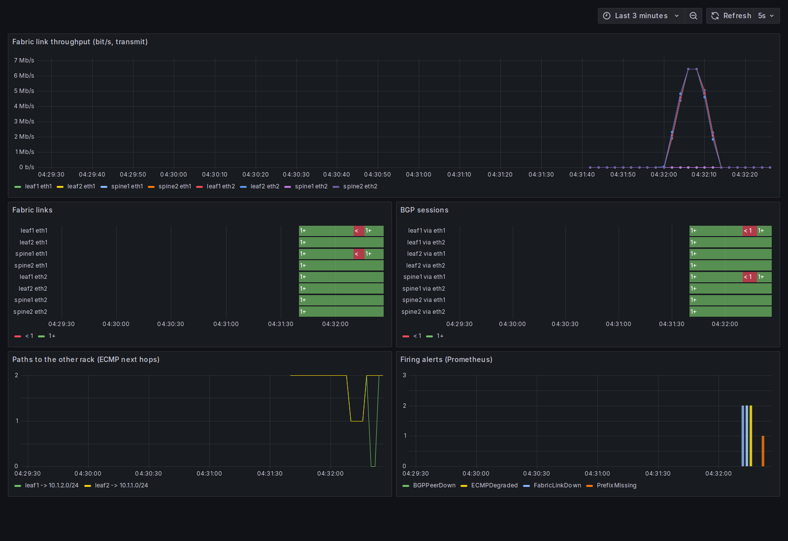

# Part C: monitoring the fabric

**Question:** when something breaks in the fabric, does monitoring notice, how fast, and does it tell the right story? Part A showed one failure that a "are the BGP sessions up?" check misses entirely: a policy mistake that keeps every session green while a rack's routes disappear.

## What's running

- **`monitoring/fabric_exporter.py`** is a small Prometheus exporter, standard library only. For each router it publishes:
  - link state and byte counters, read from `/sys` inside the container,
  - BGP session state, from FRR's `vtysh` JSON,
  - for each leaf, how many working paths (ECMP next hops) it has to the other rack.
- **Prometheus 2.55.1** scrapes it every 2 s and evaluates four alert rules (`monitoring/alerts.yml`):

| Alert | Fires when | Why it exists |
|---|---|---|
| FabricLinkDown | an interface's operstate isn't `up` for 2 s | the obvious one |
| BGPPeerDown | a session isn't Established for 4 s | catches the silent failures BFD catches |
| ECMPDegraded | a leaf has only 1 path to the other rack for 4 s | still reachable, but half the capacity is gone |
| PrefixMissing | a leaf has 0 paths to the other rack for 2 s | **the Part A misconfig: sessions up, route gone** |

- **Grafana 11.3.0** loads a provisioned dashboard (`monitoring/grafana/`) with link throughput, link and BGP state timelines, ECMP paths, and the alerts that are firing.
- **`tests/test_monitoring.py`** breaks things on purpose and checks which alerts fire, how fast, and that they clear. CI runs it on every push (`.github/workflows/monitoring.yml`), then takes a screenshot of the dashboard.

## Results

Times are measured from the moment the failure was introduced, or the fix applied. The table shows the first three CI runs, the ones the dashboard fixes below refer to:

| | [41388315089](https://github.com/zbs-ops/research-network-lab/actions/runs/41388315089) | [41388642572](https://github.com/zbs-ops/research-network-lab/actions/runs/41388642572) | [41388887136](https://github.com/zbs-ops/research-network-lab/actions/runs/41388887136) |
|---|---|---|---|
| **Link down** (leaf1 eth1): FabricLinkDown | 4.6 s | 4.6 s | 3.0 s |
| BGPPeerDown | 6.6 s | 6.6 s | 5.0 s |
| ECMPDegraded | 6.6 s | 6.6 s | 5.0 s |
| PrefixMissing (must **not** fire) | didn't | didn't | didn't |
| all clear after the link came back | 6.0 s | 6.0 s | 4.0 s |
| **Policy mistake** (leaf2 announces nothing): PrefixMissing | 5.5 s | 5.5 s | 3.5 s |
| BGPPeerDown (must **not** fire) | didn't | didn't | didn't |
| all clear after the fix | 4.0 s | 4.0 s | 2.0 s |
| **Ping traffic**, peak spine throughput | 6.32 Mbit/s | 6.34 Mbit/s | 6.46 Mbit/s |

Raw data: `results/monitoring/run-<id>.json`.

**All 11 runs.** The monitoring workflow runs on every push. From [run 41388315089](https://github.com/zbs-ops/research-network-lab/actions/runs/41388315089) to [run 41391387321](https://github.com/zbs-ops/research-network-lab/actions/runs/41391387321) it ran this test 11 times with the same code (`results/monitoring/all-runs.json`, run links inside). Across all 11:

- Link down: FabricLinkDown in 3.0–5.6 s, BGPPeerDown and ECMPDegraded in 5.0–7.6 s, all clear 4.0–6.0 s after the link came back.
- Policy mistake: PrefixMissing in 3.5–5.5 s, all clear 1.5–4.0 s after the fix.
- PrefixMissing never fired for the dead link, and BGPPeerDown never fired for the policy mistake.
- Peak ping traffic on a spine link: 5.9–7.6 Mbit/s.

**Reading the times:** each alert waits for its next scrape (every 2 s), then its next rule evaluation (every 2 s), then its `for:` duration. So detection lands on Prometheus's clock, not the failure's, and the same failure can take 3.0 s in one run and 5.6 s in another. The first two runs came out identical only because their timing happened to line up the same way.

**The important result isn't speed.** In all 11 runs, the policy mistake raised PrefixMissing while BGPPeerDown stayed silent. That's exactly the case where a session-only monitor shows everything green and a rack is unreachable. And a single dead link never raised PrefixMissing, so the two alerts tell the two failures apart.

## What broke, and how it was fixed

1. **The dashboard showed up as red and down as green.** The state panels had no colour mapping, so Grafana's default palette coloured the value 1 red. Fixed with explicit thresholds: 0 is red, 1 is green. Seen in run 41388315089's screenshot.
2. **The alerts panel said "Data does not have a time field".** It queried `ALERTS` in a state-timeline panel. It's now a bar chart of `count by (alertname) (ALERTS{alertstate="firing"})`.
3. **The dashboard understated short events.** Run 41388642572's throughput panel peaked at about 400 kb/s while the test measured 6.3 Mbit/s, and the alerts panel missed two of the alerts. Grafana assumed a 15 s step between points, so a 5-second burst got averaged away. The fix tells the datasource the real 2 s scrape interval (`timeInterval: 2s`). In the next run the panel peaked at about 6.4 Mbit/s against a measured 6.46.

## Limits

- The exporter polls each container with `docker exec` every scrape. That's fine for 4 routers, not for 400. A real deployment would export from the routers themselves (FRR's own exporter, SNMP or gNMI streaming telemetry).
- Alerts go to Prometheus only. There's no Alertmanager routing to email or chat, because nothing here should page anyone.
- Throughput is measured from interface counters, so it's link utilisation, not application throughput. Part B covers the latter.
