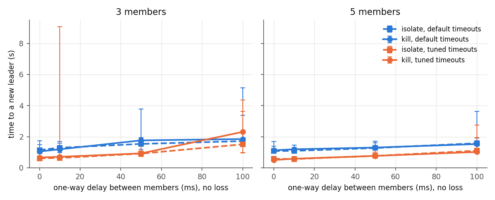
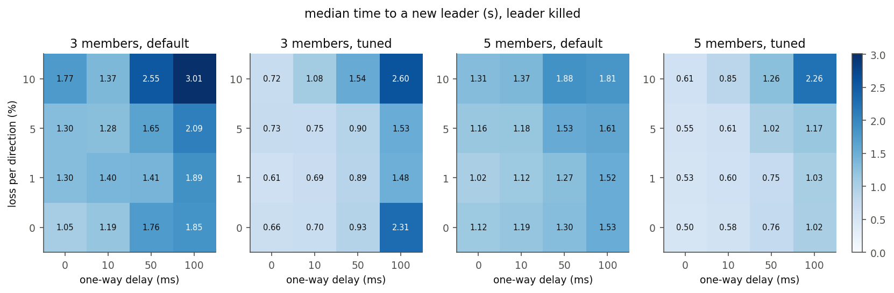

# Part D: Raft under network faults

**Question:** research networks run replicated control-plane services (configuration stores, schedulers, Kubernetes) on Raft. When the network between the replicas misbehaves (a slow or lossy path, a dead node, a cut link), how long is there no leader, how much of a steady write load fails, which side of a split keeps working, and is any acknowledged write lost?

**Setup** (`partd/`, run in GitHub Actions by `.github/workflows/partd.yml`):

- **etcd v3.5.35**, the official release binary, downloaded in CI and checked against the release's `SHA256SUMS`. Clusters of **3 and 5 members**.
- **One Linux network namespace per member**, each with two interfaces on two bridges: a peer interface for Raft traffic and a client interface for the test client (`partd/net.py`). Faults only touch the peer side, so the client's own path stays clean and every outage the client sees comes from Raft.
- **Delay and loss:** `tc netem` on every member's peer interface, egress. A packet between two members crosses one netem, so "50 ms" is the one-way delay between any two members (100 ms round trip) and "5%" is the loss in each direction. The grid is every combination of 0, 10, 50 and 100 ms with 0, 1, 5 and 10% loss.
- **Faults:** the leader is **killed** (`SIGKILL`) or **isolated** (two `iptables DROP` rules on its peer interface, inside its namespace). DROP rather than REJECT, so connections hang as in a real cut instead of failing fast. **Partitions** are `DROP` rules by peer address in every member's namespace, with the old leader on the minority or the majority side.
- **Timeouts:** etcd's defaults (heartbeat 100 ms, election timeout 1,000 ms) and one tuned pair (50 ms / 500 ms). etcd 3.5 has pre-vote on by default (its startup log says `"pre-vote":true`).
- **The client** (`partd/client.py`) writes a unique key at a fixed 50 writes/s, open loop (write k is sent at k/50 s whatever happened to earlier writes), one HTTP request per write to etcd's JSON gateway, with a 2 s client timeout and no retries. In the election experiment it writes to a follower that stays healthy. In the partition experiment one client writes to each side.
- **Every trial is a fresh cluster:** new data directories (on tmpfs, so disk fsync latency doesn't mix into the network results) and a new cluster token. A trial is a few seconds of writes (3 s in the first run, 8 s in the second), the fault, 8 s (election) or 10 s (partition) until the heal, then 4–6 s more. Isolations and partitions are then healed; a killed leader stays dead.
- **After every trial**, a linearizable range read returns every key the client wrote, and each acknowledged key is checked for presence and value.
- **Election time comes from etcd's own log:** the time from the fault to the first `became leader` by another member, and the number of elections (`became candidate`) that took.
- Repetition is the outer loop, so drift on a runner spreads across all configurations. Each of the ten jobs (cluster size × timeout pair × fault, plus one partition job per size) runs on its own runner.

**Runs used.** Two full runs, each with 5 repetitions of every election configuration and partition trials. Every number below is median [min–max] over both runs together, with the run links next to it:

- [run 42452414571](https://github.com/zbs-ops/research-network-lab/actions/runs/42452414571): 640 election trials and 20 partition trials per cluster size at 0 ms. Raw data: `results/partd/run-42452414571/`.
- [run 42454644849](https://github.com/zbs-ops/research-network-lab/actions/runs/42454644849): the same 640 election trials with an 8 s pre-fault phase, and 40 partition trials per size at 0 and 50 ms, with `ss` snapshots of the peer connections around each heal. Raw data: `results/partd/run-42454644849/`.
- [run 42452213957](https://github.com/zbs-ops/research-network-lab/actions/runs/42452213957) was a one-repetition debug run. It found two bugs (see "What broke") and none of its numbers are used.

The summaries (`results/partd/election_summary.csv`, `partition_summary.csv`, `trials.csv`) and the figures are rebuilt from the committed trial files by `partd/analyze.py` and `partd/plot.py`; the `partd-plots` workflow does this in CI and checks the result matches what's committed. The tables below are generated from those CSVs by `partd/tables.py`.

**Environment check.** Before measuring, each job runs `scripts/check_partd.sh` and its output is committed next to the data (`env-check.txt` in each job's directory). On every runner in both runs it found kernel `7.0.0-1017-azure`, 4 CPUs, 15,982–15,983 MB of RAM (`free -m`), a root shell with full capabilities (`CapEff: 000001ffffffffff`), `iproute2-6.1.0`, `iptables v1.8.10 (nf_tables)`, a working bridge + veth path into a namespace, a netem qdisc with delay and loss inside a namespace, an `iptables` rule in a namespace that doesn't appear in the root namespace, and `etcd Version: 3.5.35`.

## 1. Time to a new leader

Time from the fault to the first `became leader` by another member, in seconds, median [min–max] of 10 trials (5 per run). Rows are the delay sweep with no loss, then the loss sweep with no added delay; the full delay × loss grid is in `results/partd/election_summary.csv` and in the heatmaps below. "Elections needed" counts `became candidate` events up to the new leader (1 = the first election won).

**3 members**, time to a new leader in seconds, median [min–max]. Runs: [42452414571](https://github.com/zbs-ops/research-network-lab/actions/runs/42452414571), [42454644849](https://github.com/zbs-ops/research-network-lab/actions/runs/42454644849)

| one-way delay, loss | killed, default | killed, tuned | isolated, default | isolated, tuned | elections needed (killed: default / tuned) | trials per cell |
|---|---|---|---|---|---|---|
| 0 ms, 0% | 1.05 [0.91-1.74] | 0.66 [0.523-0.764] | 1.14 [0.988-1.48] | 0.613 [0.463-0.9] | 1 [1-1] / 1 [1-1] | 10 |
| 10 ms, 0% | 1.19 [0.988-1.68] | 0.704 [0.528-9.08] | 1.29 [0.976-1.59] | 0.631 [0.534-1.13] | 1 [1-1] / 1 [1-25] | 10 |
| 50 ms, 0% | 1.76 [1.48-3.78] | 0.926 [0.729-1.88] | 1.53 [1.17-1.93] | 0.911 [0.742-1.07] | 1 [1-3] / 1 [1-3] | 10 |
| 100 ms, 0% | 1.85 [1.56-5.13] | 2.31 [0.97-4.35] | 1.71 [1.43-3.38] | 1.51 [0.956-3.62] | 1 [1-5] / 4 [1-7] | 10 |
| 0 ms, 1% | 1.3 [0.943-1.53] | 0.611 [0.447-0.891] | 1.33 [0.928-1.72] | 0.593 [0.52-0.821] | 1 [1-1] / 1 [1-1] | 10 |
| 0 ms, 5% | 1.3 [0.957-1.72] | 0.73 [0.553-0.932] | 1.34 [0.939-1.87] | 0.641 [0.521-0.845] | 1 [1-1] / 1 [1-1] | 10 |
| 0 ms, 10% | 1.77 [1.04-5.25] | 0.715 [0.485-1.75] | 1.27 [0.976-2.11] | 0.695 [0.508-1.23] | 1 [1-3] / 1 [1-3] | 10 |

**5 members**, time to a new leader in seconds, median [min–max]. Runs: [42452414571](https://github.com/zbs-ops/research-network-lab/actions/runs/42452414571), [42454644849](https://github.com/zbs-ops/research-network-lab/actions/runs/42454644849)

| one-way delay, loss | killed, default | killed, tuned | isolated, default | isolated, tuned | elections needed (killed: default / tuned) | trials per cell |
|---|---|---|---|---|---|---|
| 0 ms, 0% | 1.12 [0.967-1.37] | 0.498 [0.439-0.588] | 1.08 [0.972-1.69] | 0.575 [0.47-0.671] | 1 [1-1] / 1 [1-1] | 10 |
| 10 ms, 0% | 1.19 [1.02-1.47] | 0.583 [0.53-0.728] | 1.09 [0.952-1.31] | 0.562 [0.495-0.731] | 1 [1-2] / 1 [1-1] | 10 |
| 50 ms, 0% | 1.3 [1.14-1.61] | 0.764 [0.691-0.992] | 1.27 [1.18-1.71] | 0.767 [0.69-1.4] | 1 [1-2] / 1 [1-2] | 10 |
| 100 ms, 0% | 1.53 [1.4-3.62] | 1.02 [0.933-2.76] | 1.58 [1.46-1.92] | 1.1 [0.961-1.93] | 1.5 [1-5] / 1.5 [1-7] | 10 |
| 0 ms, 1% | 1.02 [0.91-1.37] | 0.525 [0.444-0.722] | 1.05 [0.945-1.39] | 0.545 [0.462-0.764] | 1 [1-1] / 1 [1-1] | 10 |
| 0 ms, 5% | 1.16 [1.03-1.57] | 0.552 [0.488-0.764] | 1.11 [0.961-1.39] | 0.547 [0.475-0.723] | 1 [1-1] / 1 [1-1] | 10 |
| 0 ms, 10% | 1.31 [0.981-1.43] | 0.608 [0.481-1.08] | 1.13 [0.977-1.55] | 0.633 [0.521-1.67] | 1 [1-1] / 1 [1-1] | 10 |

What this shows:

- **The election timeout sets the floor.** With no added delay or loss, a killed leader is replaced in 1.05 s [0.91–1.74] with 3 members and 1.12 s [0.967–1.37] with 5, using the defaults. The tuned pair roughly halves that: 0.66 s [0.523–0.764] and 0.498 s [0.439–0.588]. No trial beat one election timeout by more than one heartbeat interval (default minimum 0.91 s, tuned 0.439 s): a follower's timer starts from the last heartbeat it got, which can be up to one interval before the fault.
- **Isolating the leader looks like killing it** to the rest of the cluster: 1.14 s vs 1.05 s (3 members, defaults, no delay). Either way the old leader can't vote.
- **With 5 members, delay and loss add modestly.** At 100 ms one-way: 1.53 s [1.4–3.62] with the defaults, 1.02 s [0.933–2.76] tuned. At 10% loss and no delay: 1.31 s and 0.608 s.
- **With 3 members, the tuned pair backfires at 100 ms.** A killed leader took 2.31 s [0.97–4.35] tuned against 1.85 s [1.56–5.13] with the defaults, and the median tuned trial needed 4 elections against 1. With two survivors, each needs the other's vote. A survivor becomes a candidate one round trip (200 ms) after its timer fires, once its pre-vote is granted. If the other survivor's timer fires less than one one-way delay (100 ms) later, its own pre-vote request arrives before the first has become a candidate and is granted too. Both then become candidates in the same term, each votes for itself, and the round is lost; each lost round costs another randomized timeout. etcd draws a member's election timeout from [timeout, 2 × timeout) in heartbeat ticks (`raft/raft.go`, line 1713 at v3.5.35), so the tuned pair picks one of ten values from 500 to 950 ms, against 1,000 to 1,900 ms for the defaults. In one trial (3 members, tuned, 100 ms, repetition 1 of [run 42452414571](https://github.com/zbs-ops/research-network-lab/actions/runs/42452414571)) the two survivors became candidates 94–95 ms apart in each of the first two rounds and only the fifth election produced a leader, at 2.83 s. Across the whole grid (16 delay × loss cells, killed and isolated), this is the only one of the 32 three-member cells where the tuned median is slower. With 5 members the tuned median is also slower in exactly one cell: killed leader, 100 ms and 10% loss, 2.26 s against 1.82 s (`election_summary.csv`; runs [42452414571](https://github.com/zbs-ops/research-network-lab/actions/runs/42452414571), [42454644849](https://github.com/zbs-ops/research-network-lab/actions/runs/42454644849)). Why 5 members suffer less from split votes wasn't measured.
- **One 3-member trial at only 10 ms needed 25 elections (9.08 s).** That's the largest value in the 10 ms tuned cell, and it isn't explained; see open question 1.

## 2. Writes through the fault

The client keeps writing at 50 writes/s through a follower that stays healthy. "Success" is the share of the writes sent in the 8 s after the kill that were acknowledged. "Gap" is the longest time with no acknowledgement at all, which is what an application would see as the outage. Latency is for writes before the fault with the default timeouts. It counts only writes that couldn't still be in flight when the fault hit (see "What broke"), so in run 42452414571 it rests on 1 s of writes per trial and in run 42454644849 on 6 s.

**3 members, leader killed.** Success: share of the writes sent in the 8 s after the kill that were acked. Gap: longest time with no ack, in seconds. Latency: writes before the fault, default timeouts, ms. Median [min–max] over trials. Runs: [42452414571](https://github.com/zbs-ops/research-network-lab/actions/runs/42452414571), [42454644849](https://github.com/zbs-ops/research-network-lab/actions/runs/42454644849)

| one-way delay, loss | success, default | gap, default | success, tuned | gap, tuned | p50 latency | p99 latency |
|---|---|---|---|---|---|---|
| 0 ms, 0% | 0.87 [0.782-0.887] | 1.08 [0.938-1.78] | 0.919 [0.905-0.935] | 0.69 [0.56-0.8] | 1.45 [1.4-1.5] | 1.77 [1.7-2.75] |
| 10 ms, 0% | 0.854 [0.792-0.877] | 1.22 [1.02-1.71] | 0.916 [0.11-0.938] | 0.736 [0.559-9.12] | 42 [42-42] | 42 [42-43] |
| 50 ms, 0% | 0.804 [0.752-0.835] | 1.85 [1.59-3.94] | 0.907 [0.877-0.935] | 0.987 [0.79-2.05] | 202 [202-202] | 202 [202-202] |
| 100 ms, 0% | 0.816 [0.54-0.855] | 2.16 [1.75-5.55] | 0.863 [0.657-0.93] | 2.67 [1.07-4.65] | 402 [402-402] | 408 [402-432] |
| 0 ms, 1% | 0.839 [0.81-0.89] | 1.33 [0.978-1.56] | 0.925 [0.892-0.945] | 0.639 [0.48-0.912] | 1.5 [1.4-1.5] | 3 [2-21] |
| 0 ms, 5% | 0.839 [0.785-0.882] | 1.5 [1.02-2.3] | 0.917 [0.897-0.945] | 1.08 [0.648-1.74] | 2 [2-953] | 376 [154-1444] |
| 0 ms, 10% | 0.806 [0.46-0.885] | 2 [1.45-4.49] | 0.906 [0.805-0.94] | 1.67 [0.8-3.17] | 90 [5-469] | 652 [160-1961] |

**5 members, leader killed.** Success: share of the writes sent in the 8 s after the kill that were acked. Gap: longest time with no ack, in seconds. Latency: writes before the fault, default timeouts, ms. Median [min–max] over trials. Runs: [42452414571](https://github.com/zbs-ops/research-network-lab/actions/runs/42452414571), [42454644849](https://github.com/zbs-ops/research-network-lab/actions/runs/42454644849)

| one-way delay, loss | success, default | gap, default | success, tuned | gap, tuned | p50 latency | p99 latency |
|---|---|---|---|---|---|---|
| 0 ms, 0% | 0.873 [0.83-0.885] | 1.15 [0.999-1.4] | 0.939 [0.927-0.945] | 0.53 [0.48-0.619] | 1.65 [1.2-1.9] | 2.27 [1.55-3.3] |
| 10 ms, 0% | 0.854 [0.82-0.875] | 1.22 [1.05-1.5] | 0.931 [0.912-0.94] | 0.611 [0.552-0.761] | 42 [41-42] | 42 [42-43] |
| 50 ms, 0% | 0.851 [0.805-0.882] | 1.41 [1.21-1.72] | 0.916 [0.882-0.935] | 0.87 [0.792-1.1] | 202 [201-202] | 202 [202-203] |
| 100 ms, 0% | 0.834 [0.735-0.875] | 1.69 [1.52-4.03] | 0.903 [0.855-0.932] | 1.23 [1.11-3.08] | 402 [402-402] | 421 [404-442] |
| 0 ms, 1% | 0.874 [0.83-0.89] | 1.05 [0.933-1.4] | 0.935 [0.91-0.945] | 0.559 [0.479-0.759] | 1.7 [1.2-1.9] | 17 [3-147] |
| 0 ms, 5% | 0.856 [0.805-0.873] | 1.18 [0.932-1.6] | 0.931 [0.91-0.948] | 0.669 [0.519-1.39] | 2 [1-115] | 212 [32-1383] |
| 0 ms, 10% | 0.854 [0.66-0.877] | 1.35 [1.26-3.1] | 0.925 [0.757-0.94] | 1.43 [0.684-3.09] | 133 [9-1003] | 1036 [199-1470] |

What this shows:

- **The outage is the election, plus a little.** With no added delay, 3 members and the defaults, the longest gap was 1.08 s [0.938–1.78] against an election time of 1.05 s, and 87% [78–89%] of the writes in the 8 s after the kill were acknowledged. The tuned pair cut the gap to 0.69 s [0.56–0.8].
- **A write through a follower costs four one-way delays.** The p50 was 42, 202 and 402 ms at 10, 50 and 100 ms one-way, with both cluster sizes. That fits the path: follower to leader, leader to the other members and back (the commit), then leader to the follower, which answers once it has applied the entry.
- **Loss hurts latency long before it hurts elections.** At 1% loss the p99 was 3 ms [2–21] with 3 members and 17 ms [3–147] with 5. At 10% loss, with no fault yet, the p50 was 90 ms [5–469] (3 members) and the p99 652 ms [160–1961]. Raft's traffic between members runs over TCP, so a lost packet on the commit path most likely waits for a TCP retransmission; that wasn't traced here.
- **A new leader doesn't always last.** In 25 of the 1,280 election trials, the leader elected after the fault lost its leadership again within the 8 s window. All 25 had 5% or 10% loss and 23 used the tuned pair. Two trials changed leader with no fault at all, during the writes before it: both tuned, both 10% loss (one per run; `trials.csv`, column `leader_changes_before_fault`). The longest gap of any trial, 11.8 s, is the one whose read-back failed (3 members, tuned, 100 ms, 10% loss; see "What broke"): its new leader stepped down 0.5 s after being elected.
- **At 100 ms with 3 members the picture is mixed.** The tuned pair acknowledged more of the writes, 86% [66–93%] against 82% [54–86%], but its median gap was longer, 2.67 s [1.07–4.65] against 2.16 s [1.75–5.55], which matches the split votes in section 1.
