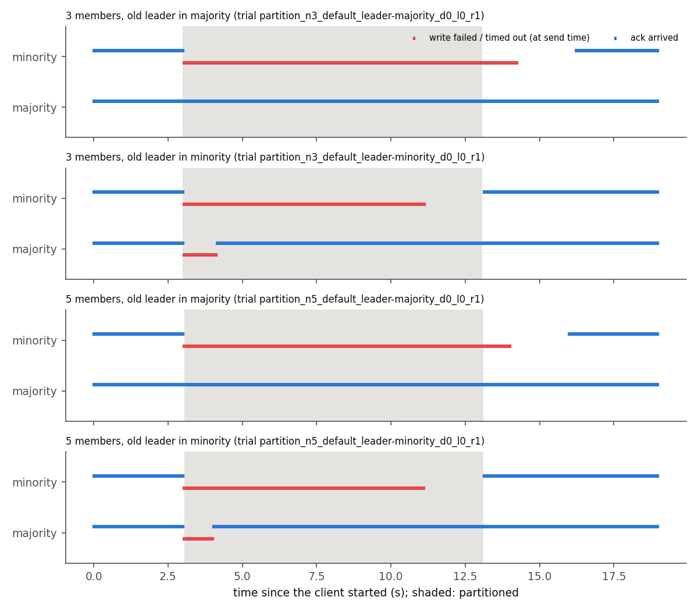

# Part D: Raft under network faults

**Question:** research networks run replicated control-plane services (configuration stores, schedulers, Kubernetes) on Raft. When the network between the replicas misbehaves (a slow or lossy path, a dead node, a cut link), how long is there no leader, how much of a steady write load fails, which side of a split keeps working, and is any acknowledged write lost?

**Setup** (`partd/`, run in GitHub Actions by `.github/workflows/partd.yml`):

- **etcd v3.5.35**, the official release binary, downloaded in CI and checked against the release's `SHA256SUMS`. Clusters of **3 and 5 members**.
- **One Linux network namespace per member**, each with two interfaces on two bridges: a peer interface for Raft traffic and a client interface for the test client (`partd/net.py`). Faults only touch the peer side, so the client's own path stays clean and every outage the client sees comes from Raft.
- **Delay and loss:** `tc netem` on every member's peer interface, egress. A packet between two members crosses one netem, so "50 ms" is the one-way delay between any two members (100 ms round trip) and "5%" is the loss in each direction. The grid is every combination of 0, 10, 50 and 100 ms with 0, 1, 5 and 10% loss.
- **Faults:** the leader is **killed** (`SIGKILL`) or **isolated** (two `iptables DROP` rules on its peer interface, inside its namespace). DROP rather than REJECT, so connections hang as in a real cut instead of failing fast. **Partitions** are `DROP` rules by peer address in every member's namespace, with the old leader on the minority or the majority side.
- **Timeouts:** etcd's defaults (heartbeat 100 ms, election timeout 1,000 ms) and one tuned pair (50 ms / 500 ms). etcd 3.5 has pre-vote on by default (its startup log says `"pre-vote":true`).
- **The client** (`partd/client.py`) writes a unique key at a fixed 50 writes/s, open loop (write k is sent at k/50 s whatever happened to earlier writes), one HTTP request per write to etcd's JSON gateway, with a 2 s client timeout and no retries. In the election experiment it writes to a follower that stays healthy. In the partition experiment one client writes to each side.
- **Every trial is a fresh cluster:** new data directories (on tmpfs, so disk fsync latency doesn't mix into the network results) and a new cluster token. A trial is a few seconds of writes (3 s in the first run, 8 s in the second), the fault, 8 s (election) or 10 s (partition; 5 to 40 s in the partition-length run) until the heal, then 4–6 s more. Isolations and partitions are then healed; a killed leader stays dead.
- **After every trial**, a linearizable range read returns every key the client wrote, and each acknowledged key is checked for presence and value.
- **Election time comes from etcd's own log:** the time from the fault to the first `became leader` by another member, and the number of elections (`became candidate`) that took.
- Repetition is the outer loop, so drift on a runner spreads across all configurations. Each of the ten jobs (cluster size × timeout pair × fault, plus one partition job per size) runs on its own runner.

**Runs used.** Two full runs, each with 5 repetitions of every election configuration and partition trials, and one run that varies the partition length. Every number below is median [min–max] over both runs together, with the run links next to it:

- [run 42452414571](https://github.com/zbs-ops/research-network-lab/actions/runs/42452414571): 640 election trials and 20 partition trials per cluster size at 0 ms. Raw data: `results/partd/run-42452414571/`.
- [run 42454644849](https://github.com/zbs-ops/research-network-lab/actions/runs/42454644849): the same 640 election trials with an 8 s pre-fault phase, and 40 partition trials per size at 0 and 50 ms, with `ss` snapshots of the peer connections around each heal. Raw data: `results/partd/run-42454644849/`.
- [run 42458127542](https://github.com/zbs-ops/research-network-lab/actions/runs/42458127542): partitions only, old leader in the majority, 0 ms, partitions of 5, 10, 20 and 40 s, 10 repetitions each per cluster size (section 4). Its 10 s trials join the 10 s partition rows. Raw data: `results/partd/run-42458127542/`.
- [run 42452213957](https://github.com/zbs-ops/research-network-lab/actions/runs/42452213957) was a one-repetition debug run. It found two bugs (see "What broke") and none of its numbers are used.

The summaries (`results/partd/election_summary.csv`, `partition_summary.csv`, `trials.csv`) and the figures are rebuilt from the committed trial files by `partd/analyze.py` and `partd/plot.py`; the `partd-plots` workflow does this in CI and checks the result matches what's committed. The tables below are generated from those CSVs by `partd/tables.py`.

**Environment check.** Before measuring, each job runs `scripts/check_partd.sh` and its output is committed next to the data (`env-check.txt` in each job's directory). On every runner in both runs it found kernel `7.0.0-1017-azure`, 4 CPUs, 15,982–15,983 MB of RAM (`free -m`), a root shell with full capabilities (`CapEff: 000001ffffffffff`), `iproute2-6.1.0`, `iptables v1.8.10 (nf_tables)`, a working bridge + veth path into a namespace, a netem qdisc with delay and loss inside a namespace, an `iptables` rule in a namespace that doesn't appear in the root namespace, and `etcd Version: 3.5.35`.

## 1. Time to a new leader

Time from the fault to the first `became leader` by another member, in seconds, median [min–max] of 10 trials (5 per run). Rows are the delay sweep with no loss, then the loss sweep with no added delay; the full delay × loss grid is in `results/partd/election_summary.csv` and in the heatmaps below. "Elections needed" counts `became candidate` events up to the new leader (1 = the first election won).

**3 members**, time to a new leader in seconds, median [min–max]. Runs: [42452414571](https://github.com/zbs-ops/research-network-lab/actions/runs/42452414571), [42454644849](https://github.com/zbs-ops/research-network-lab/actions/runs/42454644849)

| one-way delay, loss | killed, default | killed, tuned | isolated, default | isolated, tuned | elections needed (killed: default / tuned) | trials per cell |
|---|---|---|---|---|---|---|
| 0 ms, 0% | 1.05 [0.91-1.74] | 0.66 [0.523-0.764] | 1.14 [0.988-1.48] | 0.613 [0.463-0.9] | 1 [1-1] / 1 [1-1] | 10 |
| 10 ms, 0% | 1.19 [0.988-1.68] | 0.704 [0.528-9.08] | 1.29 [0.976-1.59] | 0.631 [0.534-1.13] | 1 [1-1] / 1 [1-25] | 10 |
| 50 ms, 0% | 1.76 [1.48-3.78] | 0.926 [0.729-1.88] | 1.53 [1.17-1.93] | 0.911 [0.742-1.07] | 1 [1-3] / 1 [1-3] | 10 |
| 100 ms, 0% | 1.85 [1.56-5.13] | 2.31 [0.97-4.35] | 1.71 [1.43-3.38] | 1.51 [0.956-3.62] | 1 [1-5] / 4 [1-7] | 10 |
| 0 ms, 1% | 1.3 [0.943-1.53] | 0.611 [0.447-0.891] | 1.33 [0.928-1.72] | 0.593 [0.52-0.821] | 1 [1-1] / 1 [1-1] | 10 |
| 0 ms, 5% | 1.3 [0.957-1.72] | 0.73 [0.553-0.932] | 1.34 [0.939-1.87] | 0.641 [0.521-0.845] | 1 [1-1] / 1 [1-1] | 10 |
| 0 ms, 10% | 1.77 [1.04-5.25] | 0.715 [0.485-1.75] | 1.27 [0.976-2.11] | 0.695 [0.508-1.23] | 1 [1-3] / 1 [1-3] | 10 |

**5 members**, time to a new leader in seconds, median [min–max]. Runs: [42452414571](https://github.com/zbs-ops/research-network-lab/actions/runs/42452414571), [42454644849](https://github.com/zbs-ops/research-network-lab/actions/runs/42454644849)

| one-way delay, loss | killed, default | killed, tuned | isolated, default | isolated, tuned | elections needed (killed: default / tuned) | trials per cell |
|---|---|---|---|---|---|---|
| 0 ms, 0% | 1.12 [0.967-1.37] | 0.498 [0.439-0.588] | 1.08 [0.972-1.69] | 0.575 [0.47-0.671] | 1 [1-1] / 1 [1-1] | 10 |
| 10 ms, 0% | 1.19 [1.02-1.47] | 0.583 [0.53-0.728] | 1.09 [0.952-1.31] | 0.562 [0.495-0.731] | 1 [1-2] / 1 [1-1] | 10 |
| 50 ms, 0% | 1.3 [1.14-1.61] | 0.764 [0.691-0.992] | 1.27 [1.18-1.71] | 0.767 [0.69-1.4] | 1 [1-2] / 1 [1-2] | 10 |
| 100 ms, 0% | 1.53 [1.4-3.62] | 1.02 [0.933-2.76] | 1.58 [1.46-1.92] | 1.1 [0.961-1.93] | 1.5 [1-5] / 1.5 [1-7] | 10 |
| 0 ms, 1% | 1.02 [0.91-1.37] | 0.525 [0.444-0.722] | 1.05 [0.945-1.39] | 0.545 [0.462-0.764] | 1 [1-1] / 1 [1-1] | 10 |
| 0 ms, 5% | 1.16 [1.03-1.57] | 0.552 [0.488-0.764] | 1.11 [0.961-1.39] | 0.547 [0.475-0.723] | 1 [1-1] / 1 [1-1] | 10 |
| 0 ms, 10% | 1.31 [0.981-1.43] | 0.608 [0.481-1.08] | 1.13 [0.977-1.55] | 0.633 [0.521-1.67] | 1 [1-1] / 1 [1-1] | 10 |

What this shows:

- **The election timeout sets the floor.** With no added delay or loss, a killed leader is replaced in 1.05 s [0.91–1.74] with 3 members and 1.12 s [0.967–1.37] with 5, using the defaults. The tuned pair roughly halves that: 0.66 s [0.523–0.764] and 0.498 s [0.439–0.588]. The fastest trials, 0.91 s with the defaults and 0.439 s tuned, came in just under one election timeout: etcd counts the timeout in heartbeat ticks from the last message a follower got from the leader, and that message can be up to about one heartbeat interval older than the fault.
- **Isolating the leader looks like killing it** to the rest of the cluster: 1.14 s vs 1.05 s (3 members, defaults, no delay). Either way the old leader can't vote.
- **With 5 members, delay and loss add modestly.** At 100 ms one-way: 1.53 s [1.4–3.62] with the defaults, 1.02 s [0.933–2.76] tuned. At 10% loss and no delay: 1.31 s and 0.608 s.
- **With 3 members, the tuned pair backfires at 100 ms.** A killed leader took 2.31 s [0.97–4.35] tuned against 1.85 s [1.56–5.13] with the defaults, and the median tuned trial needed 4 elections against 1. With two survivors, each needs the other's vote. A survivor becomes a candidate one round trip (200 ms) after its timer fires, once its pre-vote is granted. If the other survivor's timer fires less than one one-way delay (100 ms) later, its own pre-vote request arrives before the first has become a candidate and is granted too. Both then become candidates in the same term, each votes for itself, and the round is lost; each lost round costs another randomized timeout. etcd draws a member's election timeout from [timeout, 2 × timeout) in heartbeat ticks (`raft/raft.go`, line 1713 at v3.5.35), so the tuned pair picks one of ten values from 500 to 950 ms, against 1,000 to 1,900 ms for the defaults. In one trial (3 members, tuned, 100 ms, repetition 1 of [run 42452414571](https://github.com/zbs-ops/research-network-lab/actions/runs/42452414571)) the two survivors became candidates 94–95 ms apart in each of the first two rounds and only the fifth election produced a leader, at 2.83 s. Across the whole grid (16 delay × loss cells, killed and isolated), this is the only one of the 32 three-member cells where the tuned median is slower. With 5 members the tuned median is also slower in exactly one cell: killed leader, 100 ms and 10% loss, 2.26 s against 1.82 s (`election_summary.csv`; runs [42452414571](https://github.com/zbs-ops/research-network-lab/actions/runs/42452414571), [42454644849](https://github.com/zbs-ops/research-network-lab/actions/runs/42454644849)). Why 5 members suffer less from split votes wasn't measured.
- **One 3-member trial at only 10 ms needed 25 elections (9.08 s).** That's the largest value in the 10 ms tuned cell, and it isn't explained; see open question 1.

## 2. Writes through the fault

The client keeps writing at 50 writes/s through a follower that stays healthy. "Success" is the share of the writes sent in the 8 s after the kill that were acknowledged. "Gap" is the longest time with no acknowledgement at all, which is what an application would see as the outage. Latency is for writes before the fault with the default timeouts. It counts only writes that couldn't still be in flight when the fault hit (see "What broke"), so in run 42452414571 it rests on 1 s of writes per trial and in run 42454644849 on 6 s.

**3 members, leader killed.** Success: share of the writes sent in the 8 s after the kill that were acked. Gap: longest time with no ack, in seconds. Latency: writes before the fault, default timeouts, ms. Median [min–max] over trials. Runs: [42452414571](https://github.com/zbs-ops/research-network-lab/actions/runs/42452414571), [42454644849](https://github.com/zbs-ops/research-network-lab/actions/runs/42454644849)

| one-way delay, loss | success, default | gap, default | success, tuned | gap, tuned | p50 latency | p99 latency |
|---|---|---|---|---|---|---|
| 0 ms, 0% | 0.87 [0.782-0.887] | 1.08 [0.938-1.78] | 0.919 [0.905-0.935] | 0.69 [0.56-0.8] | 1.45 [1.4-1.5] | 1.77 [1.7-2.75] |
| 10 ms, 0% | 0.854 [0.792-0.877] | 1.22 [1.02-1.71] | 0.916 [0.11-0.938] | 0.736 [0.559-9.12] | 42 [42-42] | 42 [42-43] |
| 50 ms, 0% | 0.804 [0.752-0.835] | 1.85 [1.59-3.94] | 0.907 [0.877-0.935] | 0.987 [0.79-2.05] | 202 [202-202] | 202 [202-202] |
| 100 ms, 0% | 0.816 [0.54-0.855] | 2.16 [1.75-5.55] | 0.863 [0.657-0.93] | 2.67 [1.07-4.65] | 402 [402-402] | 408 [402-432] |
| 0 ms, 1% | 0.839 [0.81-0.89] | 1.33 [0.978-1.56] | 0.925 [0.892-0.945] | 0.639 [0.48-0.912] | 1.5 [1.4-1.5] | 3 [2-21] |
| 0 ms, 5% | 0.839 [0.785-0.882] | 1.5 [1.02-2.3] | 0.917 [0.897-0.945] | 1.08 [0.648-1.74] | 2 [2-953] | 376 [154-1444] |
| 0 ms, 10% | 0.806 [0.46-0.885] | 2 [1.45-4.49] | 0.906 [0.805-0.94] | 1.67 [0.8-3.17] | 90 [5-469] | 652 [160-1961] |

**5 members, leader killed.** Success: share of the writes sent in the 8 s after the kill that were acked. Gap: longest time with no ack, in seconds. Latency: writes before the fault, default timeouts, ms. Median [min–max] over trials. Runs: [42452414571](https://github.com/zbs-ops/research-network-lab/actions/runs/42452414571), [42454644849](https://github.com/zbs-ops/research-network-lab/actions/runs/42454644849)

| one-way delay, loss | success, default | gap, default | success, tuned | gap, tuned | p50 latency | p99 latency |
|---|---|---|---|---|---|---|
| 0 ms, 0% | 0.873 [0.83-0.885] | 1.15 [0.999-1.4] | 0.939 [0.927-0.945] | 0.53 [0.48-0.619] | 1.65 [1.2-1.9] | 2.27 [1.55-3.3] |
| 10 ms, 0% | 0.854 [0.82-0.875] | 1.22 [1.05-1.5] | 0.931 [0.912-0.94] | 0.611 [0.552-0.761] | 42 [41-42] | 42 [42-43] |
| 50 ms, 0% | 0.851 [0.805-0.882] | 1.41 [1.21-1.72] | 0.916 [0.882-0.935] | 0.87 [0.792-1.1] | 202 [201-202] | 202 [202-203] |
| 100 ms, 0% | 0.834 [0.735-0.875] | 1.69 [1.52-4.03] | 0.903 [0.855-0.932] | 1.23 [1.11-3.08] | 402 [402-402] | 421 [404-442] |
| 0 ms, 1% | 0.874 [0.83-0.89] | 1.05 [0.933-1.4] | 0.935 [0.91-0.945] | 0.559 [0.479-0.759] | 1.7 [1.2-1.9] | 17 [3-147] |
| 0 ms, 5% | 0.856 [0.805-0.873] | 1.18 [0.932-1.6] | 0.931 [0.91-0.948] | 0.669 [0.519-1.39] | 2 [1-115] | 212 [32-1383] |
| 0 ms, 10% | 0.854 [0.66-0.877] | 1.35 [1.26-3.1] | 0.925 [0.757-0.94] | 1.43 [0.684-3.09] | 133 [9-1003] | 1036 [199-1470] |

What this shows:

- **The outage is the election, plus a little.** With no added delay, 3 members and the defaults, the longest gap was 1.08 s [0.938–1.78] against an election time of 1.05 s, and 87% [78–89%] of the writes in the 8 s after the kill were acknowledged. The tuned pair cut the gap to 0.69 s [0.56–0.8].
- **A write through a follower costs four one-way delays.** The p50 was 42, 202 and 402 ms at 10, 50 and 100 ms one-way, with both cluster sizes. That fits the path: follower to leader, leader to the other members and back (the commit), then leader to the follower, which answers once it has applied the entry.
- **Loss hurts latency long before it hurts elections.** At 1% loss the p99 was 3 ms [2–21] with 3 members and 17 ms [3–147] with 5. At 10% loss, with no fault yet, the p50 was 90 ms [5–469] (3 members) and the p99 652 ms [160–1961]. Raft's traffic between members runs over TCP, so a lost packet on the commit path most likely waits for a TCP retransmission; that wasn't traced here.
- **A new leader doesn't always last** (`trials.csv`, runs [42452414571](https://github.com/zbs-ops/research-network-lab/actions/runs/42452414571), [42454644849](https://github.com/zbs-ops/research-network-lab/actions/runs/42454644849)). In 25 of the 1,280 election trials, the leader elected after the fault lost its leadership again within the 8 s window. All 25 had 5% or 10% loss and 23 used the tuned pair. Two trials changed leader with no fault at all, during the writes before it: both tuned, both 10% loss (one per run; `trials.csv`, column `leader_changes_before_fault`). The longest gap of any trial, 11.8 s, is the one whose read-back failed (3 members, tuned, 100 ms, 10% loss, run [42452414571](https://github.com/zbs-ops/research-network-lab/actions/runs/42452414571); see "What broke"): its new leader stepped down 0.5 s after being elected.
- **At 100 ms with 3 members the picture is mixed.** The tuned pair acknowledged more of the writes, 86% [66–93%] against 82% [54–86%], but its median gap was longer, 2.67 s [1.07–4.65] against 2.16 s [1.75–5.55], which matches the split votes in section 1.

## 3. Minority vs majority partitions

The cluster is split for 10 s into a minority (1 of 3, or 2 of 5) and a majority, with the old leader on one side or the other. One client writes to a member on each side: to the old leader itself when it's in the minority, otherwise to a follower. "Acks during the partition" counts acknowledgements that *arrived* while the cut was complete, out of about 500 writes sent. "Longest gap" runs to the end of the trial, so it includes the time to recover after the heal.

| members | one-way delay | old leader in | writer on | trials | acks during the partition | longest gap (s) | first ack after heal (s) | new leader after (s) | runs |
|---|---|---|---|---|---|---|---|---|---|
| 3 | 0 ms | majority | majority | 30 | 499 [498-499] | 0.0227 [0.0218-0.0281] | 0.0133 [0.00242-0.0223] | – | [42452414571](https://github.com/zbs-ops/research-network-lab/actions/runs/42452414571), [42454644849](https://github.com/zbs-ops/research-network-lab/actions/runs/42454644849), [42458127542](https://github.com/zbs-ops/research-network-lab/actions/runs/42458127542) |
| 3 | 0 ms | majority | minority | 30 | 0 [0-0] | 13 [13-13] | 3.06 [2.81-3.28] | – | [42452414571](https://github.com/zbs-ops/research-network-lab/actions/runs/42452414571), [42454644849](https://github.com/zbs-ops/research-network-lab/actions/runs/42454644849), [42458127542](https://github.com/zbs-ops/research-network-lab/actions/runs/42458127542) |
| 3 | 0 ms | minority | majority | 20 | 442 [423-453] | 1.23 [0.938-1.79] | 0.0164 [0.00311-0.0244] | 1.21 [0.918-1.77] | [42452414571](https://github.com/zbs-ops/research-network-lab/actions/runs/42452414571), [42454644849](https://github.com/zbs-ops/research-network-lab/actions/runs/42454644849) |
| 3 | 0 ms | minority | minority | 20 | 0 [0-0] | 10 [10-10] | 0.0285 [0.00881-0.117] | 1.21 [0.918-1.77] | [42452414571](https://github.com/zbs-ops/research-network-lab/actions/runs/42452414571), [42454644849](https://github.com/zbs-ops/research-network-lab/actions/runs/42454644849) |
| 3 | 50 ms | majority | majority | 10 | 499 [499-499] | 0.203 [0.202-0.203] | 0.213 [0.207-0.22] | – | [42454644849](https://github.com/zbs-ops/research-network-lab/actions/runs/42454644849) |
| 3 | 50 ms | majority | minority | 10 | 0 [0-0] | 15 [14-15] | 4.52 [4.2-4.72] | – | [42454644849](https://github.com/zbs-ops/research-network-lab/actions/runs/42454644849) |
| 3 | 50 ms | minority | majority | 10 | 430 [406-443] | 1.71 [1.38-2.44] | 0.212 [0.116-0.222] | 1.57 [1.11-2.07] | [42454644849](https://github.com/zbs-ops/research-network-lab/actions/runs/42454644849) |
| 3 | 50 ms | minority | minority | 10 | 0 [0-0] | 11 [10-16] | 1.12 [0.641-6.2] | 1.57 [1.11-2.07] | [42454644849](https://github.com/zbs-ops/research-network-lab/actions/runs/42454644849) |
| 5 | 0 ms | majority | majority | 30 | 496 [496-497] | 0.0256 [0.0224-0.0342] | 0.0164 [0.00229-0.0214] | – | [42452414571](https://github.com/zbs-ops/research-network-lab/actions/runs/42452414571), [42454644849](https://github.com/zbs-ops/research-network-lab/actions/runs/42454644849), [42458127542](https://github.com/zbs-ops/research-network-lab/actions/runs/42458127542) |
| 5 | 0 ms | majority | minority | 30 | 0 [0-0] | 13 [13-13] | 2.99 [2.77-3.19] | – | [42452414571](https://github.com/zbs-ops/research-network-lab/actions/runs/42452414571), [42454644849](https://github.com/zbs-ops/research-network-lab/actions/runs/42454644849), [42458127542](https://github.com/zbs-ops/research-network-lab/actions/runs/42458127542) |
| 5 | 0 ms | minority | majority | 20 | 444 [422-452] | 1.11 [1-1.56] | 0.0177 [0.00287-0.024] | 1.05 [0.921-1.49] | [42452414571](https://github.com/zbs-ops/research-network-lab/actions/runs/42452414571), [42454644849](https://github.com/zbs-ops/research-network-lab/actions/runs/42454644849) |
| 5 | 0 ms | minority | minority | 20 | 0 [0-0] | 10 [10-10] | 0.0558 [0.0176-0.125] | 1.05 [0.921-1.49] | [42452414571](https://github.com/zbs-ops/research-network-lab/actions/runs/42452414571), [42454644849](https://github.com/zbs-ops/research-network-lab/actions/runs/42454644849) |
| 5 | 50 ms | majority | majority | 10 | 496 [496-497] | 0.203 [0.203-0.203] | 0.218 [0.205-0.222] | – | [42454644849](https://github.com/zbs-ops/research-network-lab/actions/runs/42454644849) |
| 5 | 50 ms | majority | minority | 10 | 0 [0-0] | 14 [14-14] | 3.89 [3.73-4.17] | – | [42454644849](https://github.com/zbs-ops/research-network-lab/actions/runs/42454644849) |
| 5 | 50 ms | minority | majority | 10 | 430 [398-447] | 1.86 [1.33-2.46] | 0.211 [0.204-0.222] | 1.57 [1.14-2.07] | [42454644849](https://github.com/zbs-ops/research-network-lab/actions/runs/42454644849) |
| 5 | 50 ms | minority | minority | 10 | 0 [0-0] | 11 [10-16] | 1.06 [0.407-6.18] | 1.57 [1.14-2.07] | [42454644849](https://github.com/zbs-ops/research-network-lab/actions/runs/42454644849) |

What this shows (runs [42452414571](https://github.com/zbs-ops/research-network-lab/actions/runs/42452414571), [42454644849](https://github.com/zbs-ops/research-network-lab/actions/runs/42454644849) and [42458127542](https://github.com/zbs-ops/research-network-lab/actions/runs/42458127542), 200 partition trials including section 4's):

- **Only the majority accepts writes.** The minority writer got 0 acknowledgements during the partition in every one of the 200 trials: 3 and 5 members, 0 and 50 ms, 5 to 40 s, old leader on either side.
- **With the old leader in the majority, the majority doesn't notice.** Every write was acknowledged (498–499 of about 500 in a 10 s partition with 3 members, 496–497 with 5; putting the cut in place took 16–22 ms with 3 members and 58–73 ms with 5, so slightly fewer writes fall inside it) and the longest gap stayed at the sending interval (0.0227 s with 3 members at 0 ms). The cut-off follower keeps trying to start elections, but with pre-vote it never wins a pre-vote, so it never raises the term: every member was still at term 2 after the heal, in all 140 of these trials (`terms_after` in each trial file).
- **With the old leader in the minority, the majority elects a new one** in 1.21 s [0.918–1.77] with 3 members and 1.05 s [0.921–1.49] with 5 at 0 ms, and every member ended at term 3, one election. The old leader steps down only when it notices it has lost its quorum: 1.39–1.80 s after the cut across these 60 trials (its own `became follower` event). So in 47 of the 60 there were two leaders at once, for up to 0.80 s. The old one acknowledged nothing in that time: a leader can't commit without a majority.
- **After the heal, the old leader's side recovers at once, a cut-off follower doesn't.** When the old leader was in the minority, its writer got an ack again 0.0285 s [0.00881–0.117] after the heal (3 members, 0 ms). When a follower was cut off for 10 s, it took 3.06 s [2.81–3.28], although it logged the leader again 0.026–0.138 s after the heal (its `elected leader` event, 30 trials). Section 4 traces why, and shows that 10 s is an unlucky length.

## 4. Recovery after a heal depends on how long the partition lasted

A follower that was cut off for 10 s took about 3 s after the heal to acknowledge a write again (section 3). To find out why, run [42454644849](https://github.com/zbs-ops/research-network-lab/actions/runs/42454644849) and run [42458127542](https://github.com/zbs-ops/research-network-lab/actions/runs/42458127542) record `ss -tino` for every member's peer connections 0.15 s before each heal and 1 s after it, and run 42458127542 varies the partition length (old leader in the majority, 0 ms). `partd/heal_sockets.py` takes the leader's connection to each cut-off member with the most unsent data, reads when its retransmission timer would next fire, finds when the leader's etcd gave up on its log-entry stream to that member (`lost TCP streaming connection` on `stream MsgApp v2`, from the run's etcd logs), and lines both up with the cut-off member's first ack after the heal. The results are `heal_sockets.csv` in each of the two run directories.

The cut-off member's first ack after the heal, by partition length (old leader in the majority, 0 ms; median [min–max]):

| members | partition length | trials | acks during the partition | first ack after heal (s) | runs |
|---|---|---|---|---|---|
| 3 | 5 s | 10 | 0 [0-0] | 0.0213 [0.00867-0.195] | [42458127542](https://github.com/zbs-ops/research-network-lab/actions/runs/42458127542) |
| 3 | 10 s | 30 | 0 [0-0] | 3.06 [2.81-3.28] | [42452414571](https://github.com/zbs-ops/research-network-lab/actions/runs/42452414571), [42454644849](https://github.com/zbs-ops/research-network-lab/actions/runs/42454644849), [42458127542](https://github.com/zbs-ops/research-network-lab/actions/runs/42458127542) |
| 3 | 20 s | 10 | 0 [0-0] | 0.0861 [0.0306-0.144] | [42458127542](https://github.com/zbs-ops/research-network-lab/actions/runs/42458127542) |
| 3 | 40 s | 10 | 0 [0-0] | 0.115 [0.0578-5.08] | [42458127542](https://github.com/zbs-ops/research-network-lab/actions/runs/42458127542) |
| 5 | 5 s | 10 | 0 [0-0] | 0.0223 [0.0119-1.37] | [42458127542](https://github.com/zbs-ops/research-network-lab/actions/runs/42458127542) |
| 5 | 10 s | 30 | 0 [0-0] | 2.99 [2.77-3.19] | [42452414571](https://github.com/zbs-ops/research-network-lab/actions/runs/42452414571), [42454644849](https://github.com/zbs-ops/research-network-lab/actions/runs/42454644849), [42458127542](https://github.com/zbs-ops/research-network-lab/actions/runs/42458127542) |
| 5 | 20 s | 10 | 0 [0-0] | 0.0784 [0.00164-0.121] | [42458127542](https://github.com/zbs-ops/research-network-lab/actions/runs/42458127542) |
| 5 | 40 s | 10 | 0 [0-0] | 0.123 [0.0371-0.22] | [42458127542](https://github.com/zbs-ops/research-network-lab/actions/runs/42458127542) |

What happens:

- **etcd gives up on the stuck stream about 13–14 s after the cut.** The leader keeps writing log entries to the cut-off member until the connection's buffers fill and the write blocks. In every trial where the leader dropped that stream, it did so 12.8–14.0 s after the cut, whatever the delay or the partition length (3 and 5 members, 0 and 50 ms, 10 to 40 s; in the trials read in full the log shows a write `i/o timeout`).
- **20 and 40 s partitions: the reset happens during the cut, and recovery is quick.** In all 40 of these trials the stream was dropped before the heal, and the cut-off member acked 0.0784–0.123 s after the heal (medians of the four cells). Its old connection's backed-off timer still had 5.74–6.20 s (20 s) or 11.85 s (40 s) to run, so recovery didn't wait for it. One 3-member 40 s trial still took 5.08 s, unexplained.
- **10 s partitions: the reset would come 2.8–4.0 s after the heal, so recovery waits for whichever comes first.** At 0 ms that's the kernel: the leader had 42–47 KB queued for the cut-off member on a connection that had backed off 5 times (`ss` shows `backoff:5` with a base `rto:201` in ms, or the doubled `rto:6432` directly, about 6.4 s between attempts). Its next attempt was due 2.76–2.85 s after the heal, and the first ack came 2.81–3.27 s after the heal (40 trials in the two runs). At 50 ms the base RTO is longer (`rto:301`, or `rto:9632` backed off), so the next attempt wasn't due until 8.98–9.46 s after the heal. There the stream reset came first, 12.81–13.97 s after the cut, and the first ack followed 3.73–4.72 s after the heal (20 trials, run 42454644849).
- **5 s partitions recover quickly too, for a reason I haven't found.** The stream isn't reset that early, and the backed-off connection's next attempt was due 1.28–1.38 s after the heal, yet the cut-off member acked 0.0213 s (3 members) and 0.0223 s (5 members) after the heal (medians). In the trial read in full, the stuck connection had drained within 1 s of the heal. See open question 3.

So a member that rejoins after a partition can stay unable to serve writes for seconds, and how long depends on whether the partition outlasted etcd's stream reset (about 13–14 s here), not on Raft. Of the four lengths measured, 10 s was the worst: long enough for TCP to back off, too short for etcd to have reset the stream. Where that window starts and ends between 5 s and 20 s wasn't measured. An application that sends writes to whichever member it can reach would see those seconds as an outage on that member.

With the old leader in the minority, the old leader's writer recovered in 0.01–0.13 s at 0 ms (run 42454644849), although the new leader's connections to it showed similar backed-off timers (2.79–4.01 s left). Why that path doesn't wait isn't established either; see open question 2.

## 5. No acknowledged write was lost

After every trial (after the heal, for isolations and partitions) a linearizable range read fetched every key the client had written, and each acknowledged write was checked for presence and value.

Election trials with a completed read-back: 1279 (1 read-back failed), 1027962 acknowledged writes, 0 missing or wrong. Partition trials: 394227 acknowledged writes, 0 missing or wrong. Runs: [42452414571](https://github.com/zbs-ops/research-network-lab/actions/runs/42452414571), [42454644849](https://github.com/zbs-ops/research-network-lab/actions/runs/42454644849), [42458127542](https://github.com/zbs-ops/research-network-lab/actions/runs/42458127542)

- **Every acknowledged write survived:** 1,027,962 in the 1,279 election trials with a completed read-back and 394,227 in the 200 partition trials, with 0 missing and 0 with the wrong value. The old leader, cut off in the minority, acknowledged none of the writes sent to it during the partition, so there was nothing there that had to survive.
- **A timeout says nothing about the outcome.** Of the writes the client gave up on (timed out or got an error), 34,149 of 91,288 in the election trials and 28,921 of 135,773 in the partition trials were committed anyway (`unacked_committed` in `trials.csv`). A client that retries a timed-out write without making it idempotent would write it twice.
- **Writes in flight when the leader died weren't lost either.** In the trial behind the "pre-fault p99" problem (5 members, defaults, 50 ms, repetition 1 of [run 42452414571](https://github.com/zbs-ops/research-network-lab/actions/runs/42452414571)), five writes sent 0.06–0.14 s before the kill were acknowledged about 1.7 s later, after the new leader had committed them, and all five are in the read-back.
- One election trial couldn't be checked (its read-back failed; see "What broke"), so the count above is over the other 1,279.

This is a check of etcd under these faults, not a proof. Each trial checks one client's writes with unique keys against one final read; it doesn't look for stale reads or check histories the way Jepsen does.

## What broke, and the fixes

Each of these turned up in a CI run, was traced to a cause, and was fixed in its own commit before the numbers above were computed.

- **A crash right after some heals.** Two isolate trials in the debug run [42452213957](https://github.com/zbs-ops/research-network-lab/actions/runs/42452213957) died with `KeyError: 'leader'`. etcd's JSON gateway leaves out fields that are zero, so a member that has no leader returns no `leader` key at all. That happens for a moment after a heal, while the rejoining member waits for a heartbeat. A missing field now means "no leader".
- **The minority looked 19% available.** In the same debug run, the minority writer of a 5-member partition showed 19% of its writes succeeding while partitioned, yet its longest stretch without an ack was the whole 10 s. All 97 of those writes were sent in the last ~2 s before the heal and acknowledged just after it (13.13–13.14 s; heal at 13.08 s). Grouping writes by send time can't tell whether a side accepted writes while cut off. The partition table counts acks by the time they *arrived*, and the timeline figure draws them that way too.
- **The heal isn't instant, and acks slipped into it.** In run [42452414571](https://github.com/zbs-ops/research-network-lab/actions/runs/42452414571), two 3-member trials still showed 55 and 67 minority acks "during" the partition. Every one arrived between the heal's start and its end: the heal flushes the rules one namespace at a time, which took 38–96 ms across the 40 partition trials, and the old leader's queued writes committed before the last flush. The partitioned interval now ends when the heal starts.
- **The pre-fault p99 looked like an election.** In the same run, the "before the fault" p99 at 50 ms one-way was 1.4–1.9 s. In one trial (5 members, default timeouts, killed leader, repetition 1) the five slowest writes were sent 0.06–0.14 s before the kill and acked about 1.7 s later, after the new leader (elected at 1.42 s) committed them; writes sent more than 2 s before the kill never took over 202 ms. The baseline now stops one client timeout (2 s) before the fault, and the pre-fault phase went from 3 s to 8 s so 6 s of baseline writes remain.
- **One read-back failed, and it wasn't a bug.** Same run, 3 members, tuned timeouts, 100 ms and 10% loss, leader killed (repetition 5): the two survivors elected a leader at 1.93 s, it stepped down ("quorum is not active") 0.5 s later, and they then split votes until the trial ended. 0 of the 400 writes sent in the 8 s after the kill were acked, and the final read got `503` for 15 s. Dropping the trial would have hidden the worst case, so it stays in the election and availability numbers and is listed as a failed read-back; its keys couldn't be checked, so it adds nothing to the safety count.
- **An explanation that only fit one partition length.** From the `ss` snapshots in run [42454644849](https://github.com/zbs-ops/research-network-lab/actions/runs/42454644849), the first version of section 4 said the kernel's TCP backoff sets how long a cut-off follower takes to recover. With only 10 s partitions measured, that was all the data could show. It also predicted that longer partitions would recover more slowly, since the backoff keeps doubling. Run [42458127542](https://github.com/zbs-ops/research-network-lab/actions/runs/42458127542) tested that and found the opposite: 20 and 40 s partitions recovered in about 0.1 s, because etcd had already reset the stuck stream during the cut. The backoff explanation holds for the 10 s case only, and section 4 now says so.
- **Heatmap colours lied across panels.** Each panel had its own colour scale, so 2.8 s in one looked like 1.9 s in the next. They share one scale now.
- **A guard that wasn't needed.** `net.py` turns off `bridge-nf-call-iptables`, because Docker on a runner can load `br_netfilter` and send bridged frames through a `FORWARD DROP` policy. On these runners the module wasn't loaded (each job's manifest records `"not loaded"`), so the guard did nothing.

## Open questions (not explained yet)

1. **Two survivors drawing the same election timeouts, round after round.** In the 3-member, tuned, 10 ms trial that needed 25 elections (repetition 3 of [run 42454644849](https://github.com/zbs-ops/research-network-lab/actions/runs/42454644849)), the two survivors waited the same time after becoming candidates in all 12 rounds that can be paired (0.68, 0.48, 0.53, 0.93 s and so on, agreeing within 1 ms), and so fired about 10 ms apart every time. At 10 ms one-way, draws one 50 ms tick apart would have given the earlier member time to finish both rounds, so each repeat needed equal draws from ten values. etcd v3.5.35 seeds each process's raft random source from the clock (`rand.NewSource(time.Now().UnixNano())`, `raft/raft.go` line 93), so two members shouldn't share a sequence. `partd/split_votes.py` pairs the survivors' intervals in every 3-member trial that needed more than one election: 29 of 79 paired rounds agree within 5 ms (`results/partd/split_votes.csv`). That's more than 1 in 10, but it's biased upwards, because a chain of split votes only continues when the draws match. Whether the draws are really correlated, and why, is open.
2. **Why an old leader cut off in the minority recovers at once.** After the heal, its writer got an ack within 0.01–0.13 s at 0 ms, although the new leader's connections to it showed backed-off retransmission timers with 2.79–4.01 s left, like the connections that kept a cut-off follower waiting about 3 s. At 50 ms its recovery spread from 0.41 to 6.20 s (`heal_sockets.csv`, [run 42454644849](https://github.com/zbs-ops/research-network-lab/actions/runs/42454644849)). Which connection carries the catch-up in that case wasn't traced.
3. **Why a 5 s partition recovers quickly.** After 5 s partitions (old leader in the majority, 0 ms, run [42458127542](https://github.com/zbs-ops/research-network-lab/actions/runs/42458127542)), the cut-off member acked 0.0213 s (3 members) and 0.0223 s (5 members) after the heal (medians), although its leader's log-entry connection had backed off 4 times with its next attempt due 1.28–1.38 s after the heal, and etcd hadn't reset the stream. In the trial read in full that connection was empty again 1 s after the heal. Something gets the queued data moving sooner than the retransmission timer; what wasn't found.

## Limits

- **One VM.** All members, the network emulation and the client share one 4-CPU runner and one kernel. Real replicas have their own machines, NICs and clocks.
- **Simple network faults.** Delay is constant and the same between every pair of members; loss is random and uniform. Real wide-area paths have jitter, uneven delays between sites, and bursty loss. Partitions were clean and symmetric, 10 s long at 0 and 50 ms, plus 5, 20 and 40 s at 0 ms with the old leader in the majority. Flapping links and one-way partitions weren't tested.
- **No disk.** Data directories were on tmpfs, so fsync costs nothing here. On real disks every commit waits for an fsync, which adds to every write latency above.
- **One client path.** The client always writes through a follower, which costs two extra one-way trips per write (section 2), and it never retries. A client that follows the leader, or retries on another member, would see different availability.
- **Ten trials per configuration.** Medians and ranges, no confidence intervals. The tails (the maximums) rest on one or two trials each.
- **Timing.** Election times come from etcd's log timestamps (microseconds) against the time the fault had been applied: 1.7–4.3 ms for a kill and 4.8–9.8 ms for an isolation, from the start of the command to its end. Write times are the client's, at 0.1 ms resolution.
- **One version and one tuned pair.** etcd v3.5.35 with pre-vote on, the defaults and 50 ms / 500 ms. Other Raft implementations (and etcd 3.6) may behave differently.
